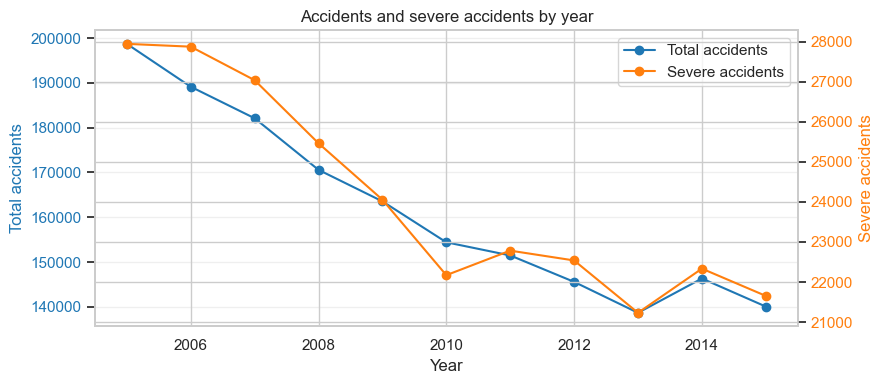

# Great Britain Road Accident Severity Analysis

Python exploratory analysis of **1,780,653 police-reported accidents from 2005–2015**, with linked vehicle and casualty tables. Ten questions compare accident volume, severe-case proportions, road conditions, vehicle involvement and casualty outcomes.

**Author:** [Mayur More](https://github.com/mayurmore0812). This is an academic portfolio project with a hypothetical consultancy scenario. No predictive model or real client engagement is claimed.



## Explore the project

- [Notebook with saved aggregate outputs](GB_Road_Accident_Severity_Analysis.ipynb)
- [Standalone HTML report](reports/GB_Road_Accident_Severity_Analysis.html): download and open locally; GitHub displays HTML source rather than hosting this report.
- [Data download, fields and provenance](docs/DATA.md)
- [Methods and limitations](docs/METHODS_AND_LIMITATIONS.md)
- [Results](docs/RESULTS.md)

## Selected findings

| Recorded-case comparison | Result | Notebook cell |
|---|---|---|
| Annual accident count | 198,735 in 2005 → 140,056 in 2015 (−29.53%) | 19 |
| Annual severe-accident count | 27,942 → 21,654 (−22.50%) | 19 |
| Severe share in 2005 / 2015 | 14.06% / 15.46% | 19 |
| Urban / rural severe share | 12.96% / 18.37% | 25 |
| Severe share in darkness without lighting | 23.85% | 31 |
| Accidents involving motorcycles over 500cc | 91,647 accidents; 36.39% severe | 37 |
| Pedestrian KSI in darkness without lighting | 2,369 of 5,186 casualties (45.68%) | 40 |

Cells are one-based notebook positions, including Markdown. Results in cells 37 and 40 are historical saved outputs; independent CSV checks cover selected accident-level aggregates and input row counts, as documented separately.

**Interpretation:** a severe accident is Fatal or Serious. Percentages describe severity among recorded accidents or casualties, not per-trip collision risk, causal effects or intervention effectiveness. Vehicle categories can overlap within an accident. These historical records do not describe current road conditions.

## Run locally

The source notebook records Python 3.12.4. Use Python 3.12 as a starting point; the dependency versions from the original run are unknown and this release has not been executed in a fresh environment.

```powershell
python -m venv .venv
.\.venv\Scripts\python.exe -m pip install -r requirements.txt
.\.venv\Scripts\python.exe -m jupyterlab
```

Download the three CSVs from [Kaggle](https://www.kaggle.com/datasets/silicon99/dft-accident-data) and extract them **beside the notebook** or keep the archive.zip as it is. Open the notebook with its working directory set to this repository root, then run the cells in order. Linux/macOS users can use `.venv/bin/python` for the same commands.

Raw CSVs total about 560 MB; analysis and joins require additional RAM. Peak memory and runtime have not been benchmarked. Data files are ignored by Git. The loader can extract `archive.zip` into the working directory if inputs are absent.

## Tools and work represented

pandas and NumPy for loading, feature derivation and grouped summaries; matplotlib and seaborn for visualization; Jupyter for reporting. The notebook distinguishes accident-level counts, deduplicated vehicle-type involvement and casualty-level KSI, and checks missing values and accident-key uniqueness.

## Attribution and reuse

Data: Department for Transport STATS19, distributed by Kaggle user `silicon99`. See [third-party notices](THIRD_PARTY_NOTICES.md) and [licence scope](docs/LICENSE_SCOPE.md). Raw records are downloaded separately. No blanket software licence has been assigned.
